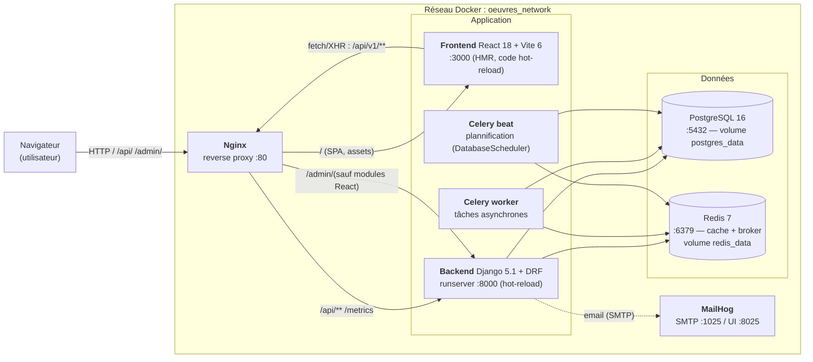
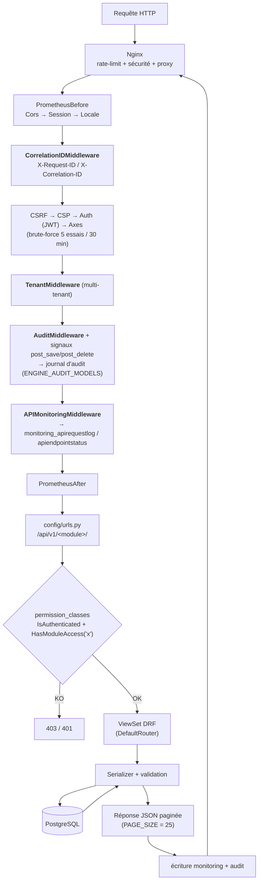
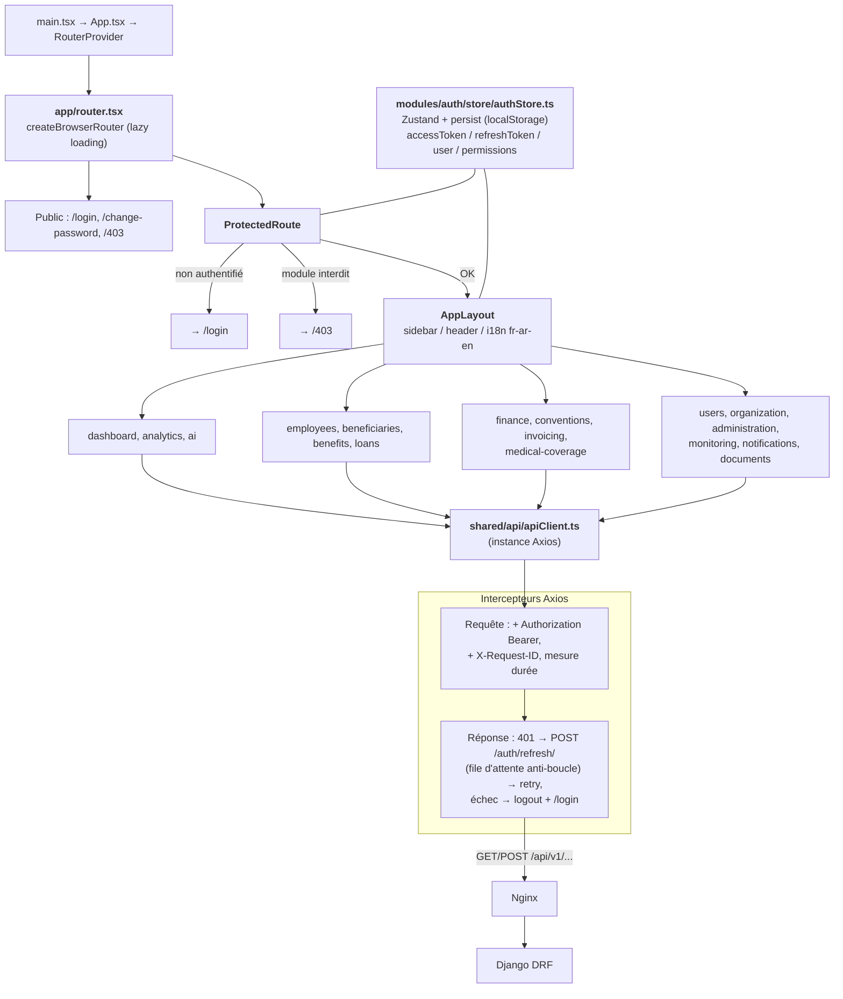
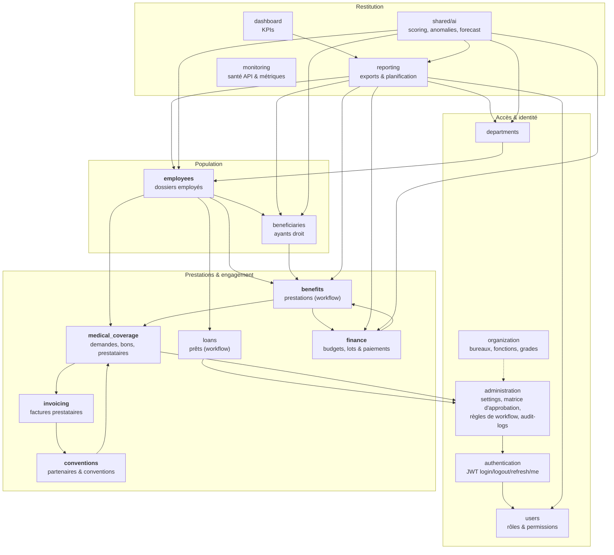
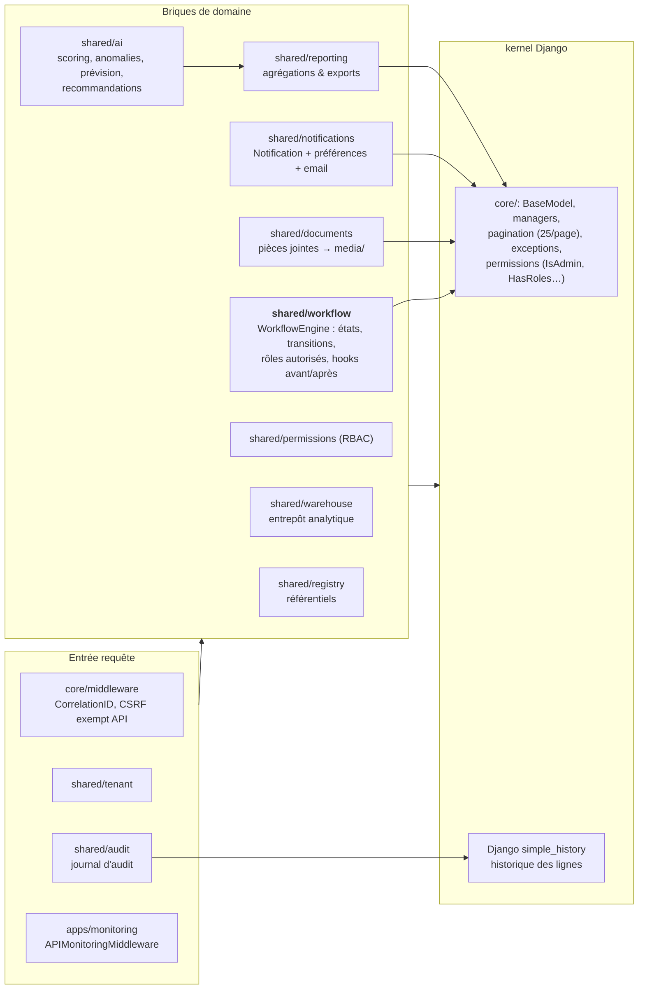
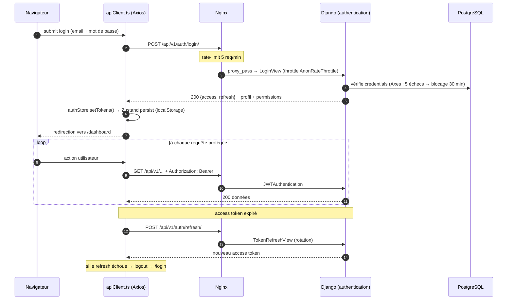
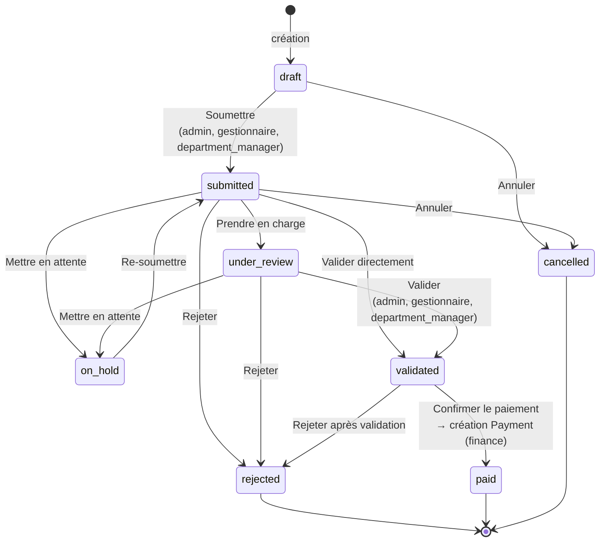
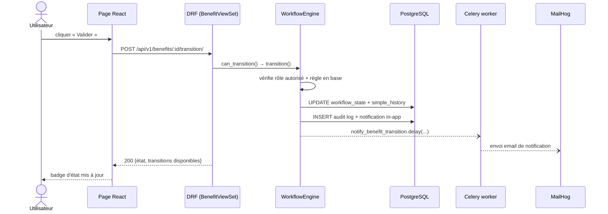
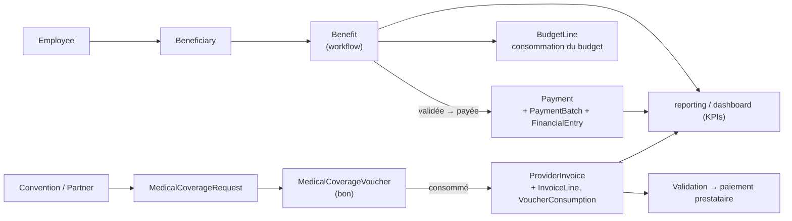
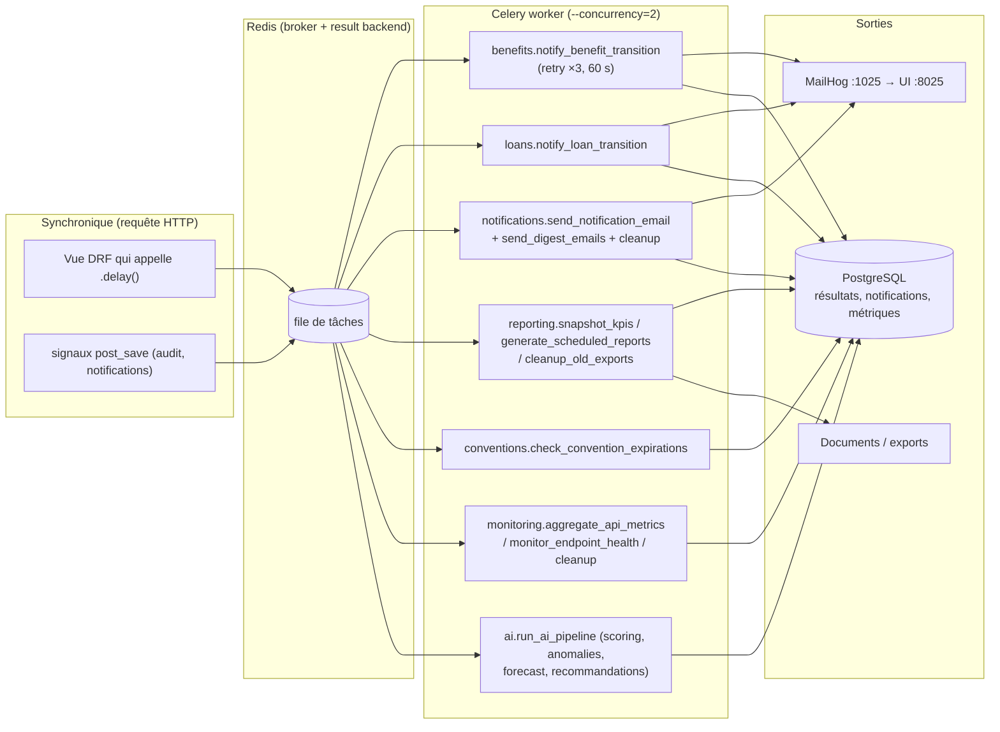

# Schéma synoptique — Composants & Interactions

> Plateforme « Oeuvres Sociales » — lecture de l'architecture **telle qu'elle est codée aujourd'hui**
> (vérifiée le 04/10/2026 sur l'environnement `docker compose` local).
>
> Deux formats : ce fichier Markdown (diagrammes Mermaid, lisible sur GitHub/GitLab)
> et le rendu navigateur [synoptic-components.html](./synoptic-components.html).

---

## 1. Vue d'ensemble — conteneurs et flux réseau

Tout tourne dans un réseau Docker `oeuvres_network`. Le navigateur ne parle qu'à **Nginx** (port 80),
qui route selon l'URL.



**Ports exposés sur l'hôte :** `80` (app), `3000` (Vite direct), `8000` (API direct),
`5432` (Postgres/DBeaver), `6379` (Redis), `1025`/`8025` (MailHog), `5050` (pgAdmin, profil `tools`).

**Routing Nginx** (`nginx/conf.d/default.conf`) :

| Location | Destination | Remarque |
|---|---|---|
| `/api/v1/auth/login/` | backend | rate-limit **5 req/min** (anti-brute-force) |
| `/api/**` | backend | rate-limit **120 req/min**, headers sécurité + CSP |
| `/admin/(roles\|permissions\|org-structure\|workflow-…)` | **frontend** | l'admin avancé est une page React |
| `/admin/**` | backend | Django admin classique |
| `/static/`, `/media/` | fichiers locaux | |
| `/metrics` | backend | Prometheus (restreint) |
| `/` | frontend | `try_files` → SPA React Router |

---

## 2. Cycle de vie d'une requête API (côté serveur)

Le chemin d'une requête `GET /api/v1/employees/` : Nginx → pile de middleware Django → URLconf → permission → ViewSet → sérialiseur → modèle.



**RBAC en deux niveaux :**
- **Backend** : `core/permissions.py` (`IsAdmin`, `IsComptable`, `HasRoles`…)
  + `HasModuleAccess("<module>")` — vérifie qu'une permission Django du module est possédée.
- **Frontend** : `ProtectedRoute module="benefits"` → `authStore.hasModuleAccess()`
  lit les permissions reçues au login, sinon redirection `/403`.

---

## 3. Frontend — structure et interactions



- Chaque dossier `frontend/src/modules/<module>` = **pages + api/ + store**, miroir d'une app Django.
- Pas de WebSocket : tout est HTTP + polling ; le temps réel est géré par le refresh automatique des données.
- Vite sert l'app sur `:3000` avec HMR ; Nginx lui sert le reste des URLs non-API.

---

## 4. Backend — applications métier et leurs dépendances



*Lecture : une flèche `A → B` signifie « l'app A importe/consomme l'app B »
(relevé par grep des `from apps.*` dans `backend/apps`).*

**Modules exposés dans `config/urls.py`** sous `/api/v1/` :
`auth, users, departments, employees, beneficiaries, benefits, loans, finance, conventions,
reporting, dashboard, notifications, monitoring, medical-coverage, invoicing, admin, organization,
tenants, audit, ai, documents` + `health/health/live/health/ready` (publics),
`/api/schema/` et `/api/docs/` (OpenAPI/Swagger via drf-spectacular).

---

## 5. Transversal — `core/` et `shared/` (les briques réutilisables)



**WorkflowMixin** est branché sur `Benefit`, `MedicalCoverageVoucher`, `MedicalCoverageRequest` et `Loan` :
la machine à états est déclarée (`apps/<module>/workflow.py`) et peut être **surchargée par la base**
(`WorkflowRule` gérée depuis l'écran *Administration → Règles de workflow*).

---

## 6. Séquence — authentification JWT



---

## 7. Flux métier — une prestation (cœur du domaine)



**Effets de bord d'une transition** (hooks du moteur, `apps/benefits/workflow.py`) :



**Chemin prestation → paiement (flux transversal) :**



---

## 8. Couche asynchrone — Celery



> **Point d'attention constaté :** le scheduler est `django_celery_beat.schedulers:DatabaseScheduler`,
> or la table `django_celery_beat_periodictask` ne contient **qu'une seule** tâche
> (`celery.backend_cleanup`, tous les jours à 04:00). Les tâches métier
> (`snapshot_kpis`, `check_convention_expirations`, `generate_scheduled_reports`,
> `run_ai_pipeline`, `aggregate_api_metrics`, `send_digest_emails`…) sont donc **définies mais non planifiées** :
> elles ne s'exécutent que si on les déclenche à la main (`celery -A config call <task>`).
> Ajouter les entrées correspondantes (interface *Administration* ou migration) activerait la
> rotation des KPIs, des rappels de conventions et des rapports planifiés.

---

## 9. Cartographie frontend ↔ API

| Module React (`frontend/src/modules/`) | Point d'entrée API (`/api/v1/`) | App Django |
|---|---|---|
| `auth` | `/auth/`, `/users/me/` | authentication, users |
| `dashboard`, `analytics` | `/dashboard/`, `/reporting/` | dashboard, reporting |
| `employees`, `beneficiaries` | `/employees/`, `/beneficiaries/` | employees, beneficiaries |
| `benefits`, `loans` | `/benefits/`, `/loans/` | benefits, loans |
| `finance` | `/finance/` | finance |
| `conventions` | `/conventions/` | conventions |
| `medical-coverage`, `invoicing` | `/medical-coverage/`, `/invoicing/` | medical_coverage, invoicing |
| `users`, `organization`, `administration` | `/users/`, `/organization/`, `/admin/` | users, organization, administration |
| `monitoring`, `notifications`, `documents`, `ai` | `/monitoring/`, `/notifications/`, `/documents/`, `/ai/` | apps + shared/* |

---

## 10. Enchaînement type (synthèse)

```mermaid
flowchart LR
    A["1. Login"] --> B["2. Dashboard / KPIs"]
    B --> C["3. Créer un employé<br/>+ ayant droits"]
    C --> D["4. Déposer une prestation<br/>ou une demande de couverture"]
    D --> E["5. Circuit de validation<br/>(workflow + matrice d'approbation)"]
    E --> F["6. Paiement / bon consommé<br/>+ facture prestataire"]
    F --> G["7. Budget & finance"]
    G --> H["8. Reporting, audit,<br/>monitoring, IA"]
    H -->|"rétroaction (KPIs, règles)"--> E
```

---

### Où regarder dans le code

| Question | Fichier |
|---|---|
| Routage API complet | `backend/config/urls.py` |
| Pile middleware | `backend/config/settings/base.py` (L81) |
| Routage Nginx | `nginx/conf.d/default.conf` |
| Moteur de workflow | `backend/shared/workflow/engine.py` + `backend/apps/benefits/workflow.py` |
| Permissions backend | `backend/core/permissions.py`, `HasModuleAccess` |
| Routes React / RBAC | `frontend/src/app/router.tsx`, `shared/components/layout/ProtectedRoute.tsx` |
| Client HTTP + refresh JWT | `frontend/src/shared/api/apiClient.ts` |
| Tâches Celery | `backend/apps/*/tasks.py`, `backend/shared/*/tasks.py` |
| Conteneurs & volumes | `docker-compose.yml` |
